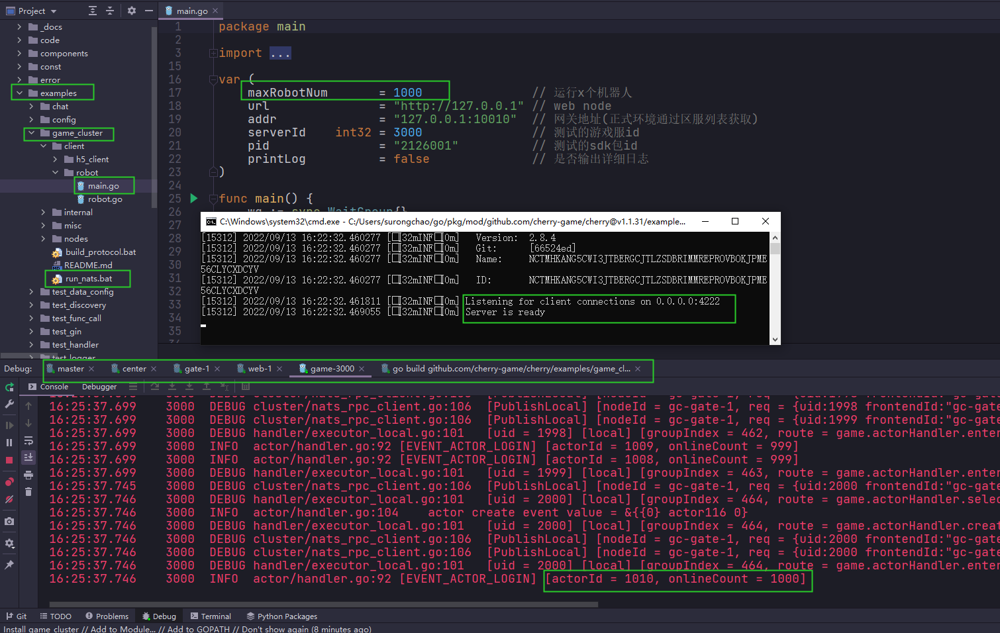

# 多节点示例

本示例适合作为游戏服务端的基础脚手架，开发者们可在此示例基础上发展出自己的游戏服务端方案。

> 示例中玩家数据都在内存里，**进程重启会还原所有数据**（代码里标了 `TODO 保存db` 的地方就是留给落库的）。

## 你会学到

- 一套典型游戏服务端的节点划分：master / center / web / gate / game 各自该做什么
- 基于 nats 的集群节点发现（谁上线了、谁掉线了）
- 消息如何从客户端一路路由到 game 节点的某个玩家 actor
- 网关的登录态校验（token → uid 绑定）与"顶号"处理
- 跨节点 rpc 调用（`Call` / `CallWait`）

**建议先把 [demo_chat](../demo_chat) 读完再来看这里**，actor、route、session 这些概念在那边讲得更细。

## 要求

- GO >= 1.24 (cherry v1.6.x 要求 go 1.24.0 以上)
- nats.io >= 2.0

## 架构

```
                        ┌──────────┐
                        │  master  │  发现服务：记录"集群里有哪些节点"
                        └────┬─────┘  （只有它，其他节点向它注册 + 发心跳）
                             │ nats
        ┌──────────┬─────────┼─────────┬──────────┐
        │          │         │         │          │
   ┌────▼───┐ ┌────▼───┐ ┌───▼────┐ ┌──▼───┐ ┌────▼────┐
   │ center │ │  web   │ │  gate  │ │ game │ │  game   │
   └────────┘ └───┬────┘ └───┬────┘ └──────┘ └─────────┘
   全局唯一业务   http接口   客户端连接   游戏逻辑（可横向扩展）
   账号 uid 分配  h5页面     消息路由
                     ▲          ▲
                     │ http     │ tcp / websocket
                  ┌──┴──────────┴──┐
                  │  h5 客户端 / 压测机器人  │
                  └────────────────┘
```

| 节点 | 职责 | 能否横向扩展 |
| --- | --- | --- |
| **master** | 发现服务，维护节点列表 | 否（只能一个） |
| **center** | 全局唯一业务：账号注册、uid 分配 | 否（示例中只能一个） |
| **web** | http 接口（注册/登录/区服列表）+ 托管 h5 | 可以 |
| **gate** | 面向客户端：连接管理、登录校验、消息转发 | 可以（顶号会跨网关通知） |
| **game** | 游戏逻辑，玩家数据 | 可以 |

## 一条消息的完整旅程

以客户端"进入角色"为例：

```
客户端 ──① GET /login─────────────▶ web      换取 token
       ◀──── token, 区服列表 ──────

客户端 ──② tcp/ws 连接 ────────────▶ gate     建 Agent + 子 actor(sid)
       ── gate.user.login(token) ─▶ gate     ActorAgent.login()
                                              校验 token → 向 center 换 uid → Bind
       ◀──── LoginResponse ────────

客户端 ──③ game.player.enter ──────▶ gate     route 第一段是 game，不是本节点
                                    gate ──转发(nats)──▶ game.ActorPlayers
                                                        └ 按 uid 找到 player 子 actor
       ◀──── 响应 ──────────────────
```

关键点：**gate 不处理游戏逻辑，只做校验和转发**；真正处理的是 game 节点上那个
以玩家 uid 命名的子 actor（路径 `10001.player.<uid>`）。

## 配置

- 参数配置文件在 `../config/demo-cluster.json`
- 策划配置文件在 `../config/data/`

配置里有几个地方值得注意：

- 节点用 **正则** 匹配：game 的 `node_id` 是 `^\\d+$`，gate 是 `^gc-gate-\\d+$`，
  所以新增 `gc-gate-2` 或 `10002` 不用改配置
- 每个节点的 `__settings__` 是本节点私有配置，业务代码用 `App().Settings()` 读
- `cluster.nats.master_node_id` 必须和 master 节点的 `node_id` 一致

> `node` 段里的 `enabled` 字段目前**不产生实际效果**（框架读了但未使用），
> 设成 `false` 不会关掉节点，别依赖它。db 段里的开关字段则叫 `enable`，拼写不同。

## 启动与调试

### 1、启动nats

> nats为高性能的分布式消息中间件，详情可通过`https://github.com/nats-io/nats-server` 进行了解。
> 本框架中所有节点都基于 nats 进行消息通信。
> 正式环境请使用集群 nats-streaming-server 进行部署 `https://github.com/nats-io/nats-streaming-server`

- Windows：`3rd/nats-server/run_nats.bat`
- Mac：`nats-server`

> 窗口显示`Listening for client connections on 0.0.0.0:4222` 代表 nats 启动成功，nats 默认监听`4222`端口

### 2、启动参数配置

- 找到`demo_cluster/nodes/main.go`，所有节点都从`main.go`启动
- `VSCode`用户在左侧栏找到`运行和调试(Debug)`按钮,启动`gc-master`、`gc-center`、`gc-web-1`、`gc-gate-1`、`gc-game-10001`
- `GoLand`用户配置启动参数(`Program arguments`)如下：

  | 名称 | 参数 |
  | --- | --- |
  | `gc-master` | `master --path=../../config/demo-cluster.json --node=gc-master` |
  | `gc-center` | `center --path=../../config/demo-cluster.json --node=gc-center` |
  | `gc-web-1` | `web --path=../../config/demo-cluster.json --node=gc-web-1` |
  | `gc-gate-1` | `gate --path=../../config/demo-cluster.json --node=gc-gate-1` |
  | `gc-game-10001` | `game --path=../../config/demo-cluster.json --node=10001` |

> **启动顺序很重要**：master 必须最先起，center 次之。
> gate / game / web 都注册了 `check_center` 组件，会等 center 就绪后才继续。
> 工作目录必须是 `demo_cluster/nodes`（配置和静态文件都是相对路径）。

## 测试

客户端演示分为两种：

- `robot_client` 为 go 实现的游戏压测客户端，使用 `tcp/protobuf` 协议
- `nodes/web/view/` 为 h5 实现的游戏客户端，使用 `websocket/protobuf` 协议

### 启动压测机器人

- 找到`demo_cluster/robot_client/main.go` 文件，并执行
- 机器人执行逻辑为：`注册帐号`、`登陆获取token`、`连接网关`、`用户登录游戏服`、`查看角色`、`创建角色`、`进入角色`
- 默认设定为创建 **5000** 个帐号，首次试跑建议把 `maxRobotNum` 改成几十个
- 全部进入游戏后进程会保持连接（方便观察在线人数），按 `Ctrl+C` 结束

### 启动 h5 客户端

- 直接访问 `http://127.0.0.1:8081`，按照界面步骤提示操作。
  - 端口以 web 进程打印的具体的值为准，如果发现端口被占用，请搜索并替换。

> demo_chat 的 http 服务也用 8081，两个示例**不要同时启动**。

## 源码讲解

### internal —— 内部业务逻辑

| 目录 | 内容 |
| --- | --- |
| `code` | 业务状态码定义（含多语言文案） |
| `component/check_center` | 启动前检查 center 是否已就绪的组件 |
| `constant` | 常用常量 |
| `data` | 策划配表包装的 struct，读取 `../config/data` 目录 |
| `event` | 游戏内事件（玩家登录/登出/创建角色） |
| `guid` | 全局 id 生成（示例实现，见文件里的 TODO） |
| `pb` | protobuf 生成的协议结构 |
| `protocol` | `.proto` 协议定义 |
| `rpc/center` | 跨节点调用 center 的封装（账号、uid 等） |
| `session_key` | session 键名常量 |
| `token` | 登录 token 的生成与校验 |
| `types` | 自定义类型，方便从配置/数据库读写 |

### nodes —— 各节点实现

| 目录 | 内容 |
| --- | --- |
| `master` | 发现服务节点 |
| `center` | 中心服节点 |
| `gate` | 网关节点。**路由规则在 `route.go`，建议重点读** |
| `game` | 游戏逻辑节点 |
| `web` | http 节点（含 h5 客户端） |
| `main.go` | 所有节点的统一入口，用命令行参数区分 |

### 其他

- `robot_client` 压测机器人（tcp/protobuf 协议）
- `build_go_protocol.bat` / `build_js_protocol.bat` 重新生成 protobuf 结构

## 排查

**节点一直打印 `center node connect fail. retrying in 2 seconds.`**
center 没起，或者 nats 没起。先确认 nats 在 `127.0.0.1:4222` 上。

**节点之间互相发现不了**
master 没有最先启动。master 负责维护节点列表，它不在就没有人能注册。

**web 节点报 `bind: Only one usage of each socket address`**
8081 被占用，最常见的原因是 demo_chat 还在跑。

**修改了 `.proto` 后编译报错**
需要重新生成：运行 `build_go_protocol.bat`，它会输出到 `internal/pb/`。

## 运行截图


